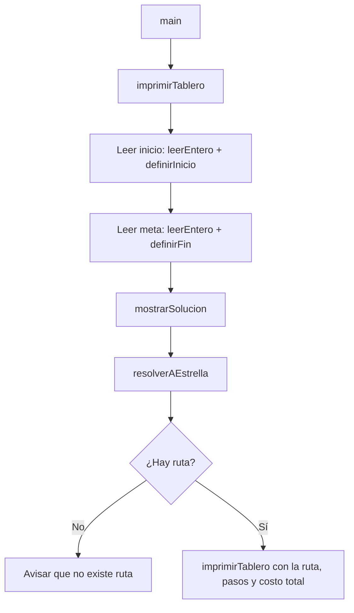

## Proyecto tipo A

Resolver con A* el siguiente laberinto. Las celdas marcadas X, representan obstáculos insalvables.

El costo real por ir a cada celda adyacente es 1, excepto los explícitamente marcados con algún valor.

El estado inicial y final son asignados por el usuario.

|     | **1** | **2** | **3** | **4** | **5** | **6** | **7** | **8** | **9** | **10** |
|:---:|:---:|:---:|:---:|:---:|:---:|:---:|:---:|:---:|:---:|:----:|
| **1**  |   |   | *4* |   | *2* |   |   | ❌ |   |   |
| **2**  | *4* |   | ❌ |   | *3* | ❌ | *2* |   |   | ❌ |
| **3**  | ❌ |   | ❌ | *2* |   | *4* | *3* | ❌ |   |   |
| **4**  | *3* | *3* | ❌ |   |   | *3* |   |   | *2* | ❌ |
| **5**  |   | *5* | *3* |   | ❌ |   | ❌ | ❌ |   |   |
| **6**  |   |   | ❌ | ❌ | *2* | ❌ |   | *4* |   | ❌ |
| **7**  | ❌ | ❌ |   | ❌ |   | *5* | *2* |   |   |   |
| **8**  |   | *3* |   | *2* |   | *3* | *2* |   | *3* | ❌ |
| **9**  |   |   | ❌ | ❌ | ❌ |   | ❌ | ❌ |   |   |
| **10** |   |   | *3* |   | *3* |   |   |   | *2* |   |

### Leyenda

- **Números en negrita** → coordenadas de fila y columna.
- *Números en cursiva* → costo de la celda.
- `❌` → obstáculo insalvable.
- Celda vacía → costo `1`.

## Requisitos

- **JDK 11 o superior.** Comprueba la versión con `javac -version`.
- Una terminal que soporte colores ANSI (la terminal de VS Code, Windows Terminal, o cualquier terminal de Mac o Linux).

## Descarga

Con Git:

```bash
git clone https://github.com/jesus24e/proyecto_A_estrella.git
cd proyecto_A_estrella
```

## Ejecución

Desde la carpeta que contiene `Laberinto.java`:

```bash
javac Laberinto.java
java Laberinto
```

El programa muestra el tablero y pide, en este orden:

```
Fila inicio (y): 1
Columna inicio (x): 1
Fila fin (y): 10
Columna fin (x): 10
```

Las coordenadas van **de 1 a 10**, igual que en la tabla de arriba. Si la casilla está fuera del tablero, es un obstáculo, o la meta coincide con el inicio, el programa avisa y vuelve a preguntar.

Después de las cuatro coordenadas, muestra:

- El tablero con la ruta encontrada.
- La lista de casillas del camino, de inicio a meta.
- El número de pasos y el costo total.

Si no existe ninguna ruta entre las dos casillas, lo indica.

### Colores del tablero

| Símbolo | Color | Significado |
|:---:|:---:|:---|
| `P` | Verde | Casilla de inicio |
| `M` | Amarillo | Meta |
| `X` | Rojo | Obstáculo |
| Carácter de la celda | Verde | Casilla que forma parte de la ruta |

## Cómo funciona

### Reglas que usa el programa

- **Movimientos:** arriba, abajo, izquierda y derecha.
- **Costo:** se paga al **entrar** a una casilla. La casilla de inicio no suma costo.
- **Heurística:** distancia Manhattan hasta la meta.

### Estructura de datos

- **`MAPA`:** matriz de caracteres con el laberinto. `X` es obstáculo, `.` es costo 1 y un dígito es su costo.
- **`Nodo`:** representa una casilla durante la búsqueda.
  - `g`: costo real acumulado desde el inicio.
  - `h`: estimación hasta la meta.
  - `f = g + h`: prioridad del nodo.
  - `padre`: nodo desde el que se llegó, para reconstruir la ruta.
- **`movimientos`:** lista de casillas que se pintan en el tablero como ruta.

### Flujo general



### Paso a paso

**1. Entrada de datos (`main`)**

1. `imprimirTablero()` muestra el laberinto vacío.
2. `leerEntero()` lee un número desde el teclado y repite la pregunta si lo escrito no es un entero.
3. `definirInicio(y, x)` convierte las coordenadas (1 a 10) a índices (0 a 9) y las valida con `comprobarValidezCasilla()`. Si son válidas, guarda la posición y `guardarMovimiento()` agrega el inicio a la lista de movimientos.
4. `definirFin(y, x)` hace lo mismo para la meta, y además rechaza que sea igual al inicio.

**2. Validación de casillas**

```
comprobarValidezCasilla  →  esTransitable  →  dentroDelTablero
```

- `dentroDelTablero()` comprueba que la fila y la columna estén dentro del rango.
- `esTransitable()` añade que la casilla no sea un obstáculo. No imprime mensajes, por lo que A* puede usarla muchas veces sin llenar la terminal.
- `comprobarValidezCasilla()` es la versión que usa la entrada del usuario: igual que `esTransitable()`, pero imprime un mensaje de error.

**3. Búsqueda con A\* (`resolverAEstrella`)**

1. Crea la **lista abierta** (candidatos) con el nodo inicial, y la **lista cerrada** (ya explorados) vacía.
2. Repite mientras haya candidatos y no se haya llegado a la meta:
   1. `buscarMenorF()` elige el nodo abierto con menor `f`.
   2. Lo mueve de la lista abierta a la cerrada.
   3. Si es la meta, `reconstruirRuta()` sigue la cadena de `padre` hacia atrás hasta el inicio y devuelve la ruta ordenada de inicio a meta.
   4. Si no, `revisarVecinos()` lo expande.
3. Si la lista abierta se vacía sin llegar a la meta, devuelve una ruta vacía.

**4. Expansión de vecinos (`revisarVecinos`)**

Para cada una de las 4 casillas vecinas:

1. Se ignora si no es transitable (`esTransitable`) o si ya está en la lista cerrada (`buscarNodo`).
2. Se calcula `nuevo_g = g del actual + costo(casilla)`.
3. Si la casilla **no está** en la lista abierta, se agrega como nodo nuevo con `h = heuristica(casilla)` y `padre = actual`.
4. Si **ya está** y `nuevo_g` es menor, se encontró un camino más barato: se actualizan `g`, `f` y `padre`.

**5. Resultado (`mostrarSolucion`)**

1. Si la ruta está vacía, imprime el tablero y avisa que no existe una ruta.
2. Si hay ruta, la guarda en `movimientos`, imprime el tablero (las casillas de la ruta se pintan en verde gracias a `casillaEnMovimientos()`), lista las casillas, y calcula los pasos y el costo total sumando `costo()` de cada casilla excepto la del inicio.

### Funciones principales

| Función | Qué hace |
|:---|:---|
| `imprimirTablero` | Dibuja el tablero con colores, el inicio, la meta y la ruta |
| `leerEntero` | Lee un entero del teclado con validación |
| `definirInicio` / `definirFin` | Validan y guardan el inicio y la meta |
| `dentroDelTablero` | Comprueba que una casilla esté en el rango |
| `esTransitable` | Comprueba rango y que no sea obstáculo, sin imprimir |
| `comprobarValidezCasilla` | Igual que `esTransitable`, pero imprime el error |
| `costo` | Devuelve el costo de entrar a una casilla |
| `heuristica` | Distancia Manhattan hasta la meta |
| `buscarNodo` | Busca un nodo por coordenadas en una lista |
| `buscarMenorF` | Devuelve el nodo con menor `f` de la lista abierta |
| `revisarVecinos` | Expande un nodo y actualiza la lista abierta |
| `reconstruirRuta` | Arma la ruta siguiendo los padres desde la meta |
| `resolverAEstrella` | Ejecuta el algoritmo y devuelve la ruta |
| `mostrarSolucion` | Muestra el tablero con la ruta, los pasos y el costo |